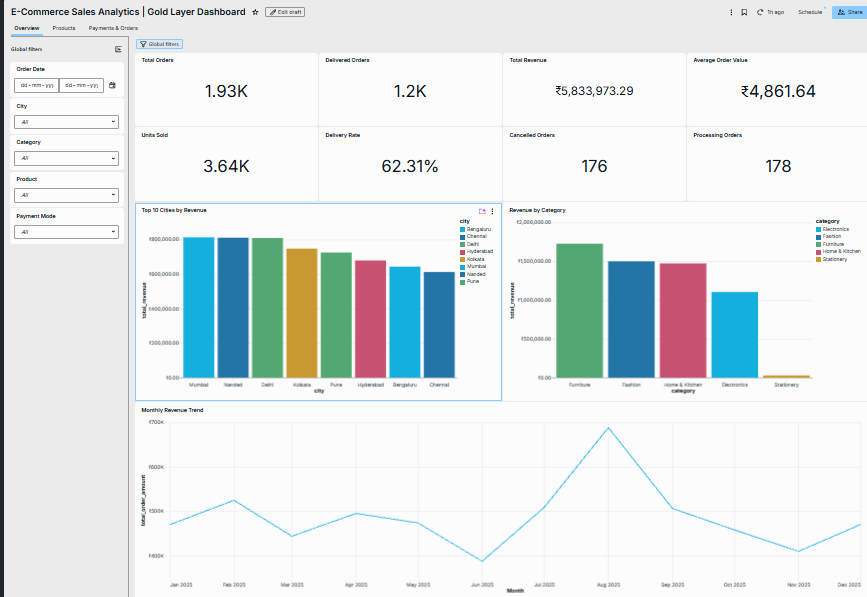
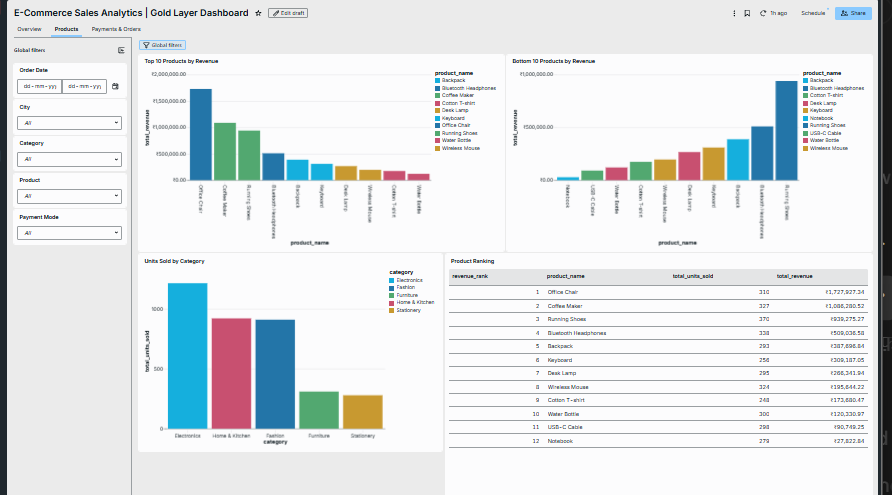
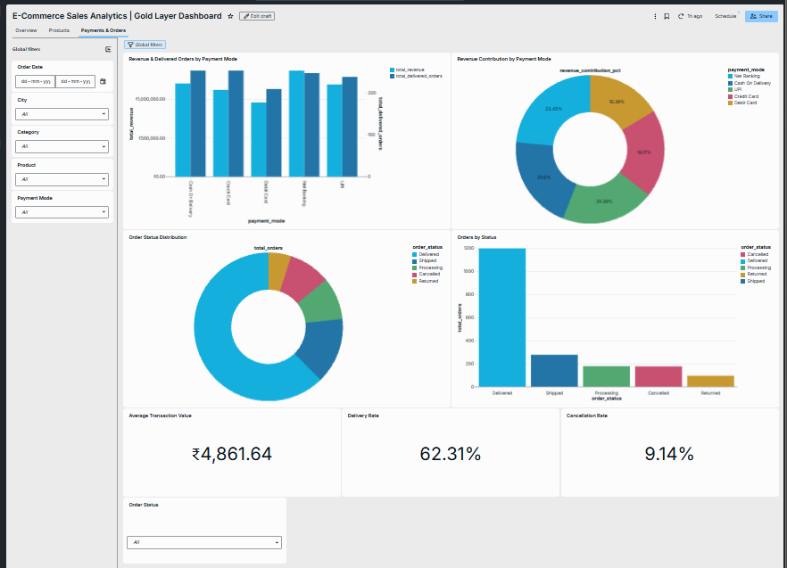

# E-Commerce Sales Analytics | Databricks Medallion Pipeline

An end-to-end data engineering and analytics project built on **Databricks Free Edition**.
Raw e-commerce order data is ingested, cleaned and validated, aggregated into business
tables, and shown in a 3-page **AI/BI dashboard**.

Built as part of my Data Engineering & Analytics internship at Innomatics Research Labs.

## Dashboard

| Overview | Products | Payments & Orders |
|---|---|---|
|  |  |  |

## Architecture

```
ecommerce_orders.csv  ->  Bronze  ->  Silver  ->  Gold  ->  AI/BI Dashboard
(Unity Catalog volume)   raw data    cleaned     business     3 pages + filters
                                     + validated  tables
```

## Tech stack

- Databricks Free Edition, Unity Catalog volume
- Lakeflow Spark Declarative Pipelines (Python / PySpark)
- Auto Loader (`cloudFiles`)
- Databricks AI/BI Dashboards, SQL

## Pipeline layers

### Bronze
- `bronze_orders_sdp`: raw CSV loaded with Auto Loader. All columns kept as strings, plus `ingestion_timestamp` and `source_file_name`.

### Silver
- `silver_orders_cleaned`: trimmed spaces, blank values to NULL, standardized text (city, category, product, payment mode, status).
- `silver_orders_typed`: dates parsed from 3 formats (`yyyy-MM-dd`, `dd-MM-yyyy`, `MM/dd/yyyy`), quantity and unit price typed, `order_amount = quantity x unit_price`, duplicate `order_id` rows removed.
- `silver_orders`: valid records.
- `silver_orders_rejected`: invalid records with a `rejection_reason`.

Validation rules:

| Rule | Check |
|---|---|
| R1 | `order_id` is present |
| R2 | `order_date` is a valid date |
| R3 | `quantity` > 0 |
| R4 | `unit_price` > 0 |
| R5 | customer_id, product_name, category, city, payment_mode are present |
| R6 | `order_status` is Delivered, Shipped, Processing, Cancelled or Returned |

### Gold
- `gold_delivered_orders`: delivered orders only (used for all sales and revenue analysis)
- `gold_city_sales`, `gold_category_sales`, `gold_product_sales`, `gold_payment_analysis`
- `gold_order_summary`: order count by status (all valid orders)
- `gold_sales_summary`: overall KPIs

## Data quality results

| Step | Rows |
|---|---|
| Raw records (bronze) | 2,000 |
| Duplicate rows removed | 20 |
| Rejected (failed validation) | 54 |
| Valid orders (silver) | 1,926 |

## Key results (delivered orders only)

| Metric | Value |
|---|---|
| Total valid orders | 1,926 |
| Delivered orders | 1,200 |
| Total revenue | Rs 5,833,973.29 |
| Average order value | Rs 4,861.64 |
| Units sold | 3,638 |
| Delivery rate | 62.31% |
| Cancellation rate | 9.14% |

Order status: Delivered 1,200, Shipped 277, Processing 178, Cancelled 176, Returned 95.

## Dashboard pages

1. **Overview**: 8 KPI cards, top cities by revenue, revenue by category, monthly revenue trend.
2. **Products**: top 10 and bottom 10 products, units sold by category, product ranking table.
3. **Payments & Orders**: revenue and orders by payment mode, payment contribution %, average transaction value, order status distribution, delivery and cancellation rates.

## Notes

- Revenue and sales analysis uses **Delivered** orders only. The order lifecycle uses all valid statuses.
- The source data has the status `Processing` (not `Pending`), so `Processing` is treated as a valid status.
- Slash dates such as `02/04/2025` are read as month/day/year.
- Date, City, Category, Product and Payment Mode filters apply to the monthly revenue trend, which is built on `gold_delivered_orders`. The other charts use pre-aggregated gold tables, which have no date column. The Order Status filter applies to the order status charts.
- The dataset has 8 cities and 12 products, so top-10 charts overlap with bottom-10 charts.

## Files

| File | Purpose |
|---|---|
| `bronze_orders_sdp.py` | Bronze ingestion |
| `silver_orders.py` | Silver cleaning, typing, validation |
| `gold_orders.py` | Gold aggregations |
| `overview.png`, `products.png`, `payments.png` | Dashboard screenshots |

## How to run

1. Upload `ecommerce_orders.csv` to a Unity Catalog volume folder.
2. Create a Lakeflow pipeline and add the three `.py` files as transformations.
3. Set the volume path in `bronze_orders_sdp.py` (`SOURCE_PATH`) to your folder.
4. Run the pipeline, then build the dashboard from the gold tables.

## Author

Tanuja Mane
